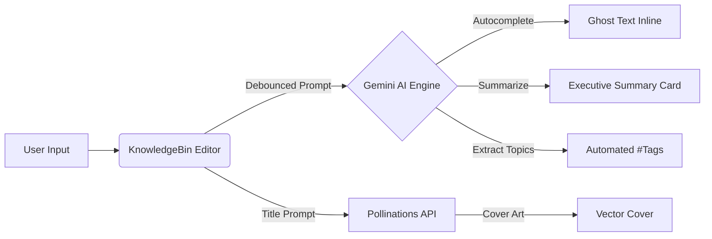

<div align="center">

# 🧠 KnowledgeBin

### *A modern, AI-powered knowledge management and note-taking workspace.*

[](https://www.djangoproject.com/)
[](https://www.python.org/)
[](https://tailwindcss.com/)
[](https://ai.google.dev/)
[](#-testing)
[](LICENSE)

<br/>

[Features](#-key-features) •
[Tech Stack](#-tech-stack) •
[Quickstart](#-quickstart) •
[AI Capabilities](#-ai-superpowers) •
[Testing](#-testing) •
[Project Structure](#-project-structure)

<br/>

</div>

---

## ✨ Overview

**KnowledgeBin** is an intuitive, distraction-free digital workspace designed for thinkers, writers, and builders. It bridges clean minimalist design with generative AI assistance, empowering you to capture ideas rapidly, format thoughts with a rich modular editor, and organize knowledge effortlessly.

Whether you're drafting documentation, organizing daily journals, or managing brainstorms, KnowledgeBin streamlines your workflow with auto-save, multi-theme customization, instant summaries, and auto-generated vector cover art.

---

## 🚀 Key Features

### ✍️ Rich-Text Block Editor
- **Powered by TipTap**: Smooth, responsive editing experience with support for bold, italic, underline, highlighting, blockquotes, and headings ($H_1$, $H_2$).
- **Interactive Task Lists**: Checkbox todo lists for managing action items directly within notes.
- **Frictionless Auto-Save**: Real-time background debounced saving with visual live status indicators so you never lose progress.

### 🤖 Built-in Gemini AI Capabilities
- **Ghost-Text Autocomplete**: Suggests natural sentence and paragraph continuations as you type.
- **Smart Summarizer**: Condenses extensive articles or meeting transcripts into bullet points or crisp executive summaries.
- **Intelligent Auto-Tagging**: Scans note content and automatically recommends structured, relevant tags for quick indexing.

### 🎨 Visual Aesthetics & Custom Themes
- **4 Color Themes**: Tailored palettes switchable in real-time without reloads:
  - ☀️ **Light**: Clean, high-contrast crisp canvas
  - 🌙 **Dark**: Elegant slate and dark navy for low light
  - 🌌 **Midnight**: Deep pitch-black OLED palette with neon accents
  - 📜 **Sepia**: Warm, vintage paper aesthetic designed for prolonged reading
- **AI Cover Generation**: Integrates with [Pollinations.ai](https://pollinations.ai/) to generate custom minimalist vector art for every notebook, or upload your own imagery.

### 🗂️ Organization & Lifecycle
- **Gallery / Grid View**: Responsive card gallery showing title, preview, tags, and covers.
- **Pinning**: Keep critical or high-priority notes pinned at the top.
- **Archive System**: Stash away completed or reference notes without cluttering the active workspace.
- **Recoverable Trash**: Two-stage soft-deletion with full restore capability or permanent deletion.
- **One-Click Export**: Export notes to structured **PDF** documents (via `html2pdf.js`) or plain **TXT** files.

---

## 🛠️ Tech Stack

| Layer | Technology | Description |
|---|---|---|
| **Backend** | [Django 5.1](https://www.djangoproject.com/) | Robust Python web framework handling ORM, authentication, and API endpoints |
| **Frontend** | [Tailwind CSS](https://tailwindcss.com/) + Vanilla JS | Utility-first responsive styling with custom CSS variables for theme switching |
| **Editor** | [TipTap Core](https://tiptap.dev/) | Headless, modular rich-text editor extensions via ESM modules |
| **AI Text Engine** | [Google Gemini REST API](https://ai.google.dev/) | Ultra-fast `gemini-3.5-flash-lite` with automatic fallback to `gemini-3.8-flash` |
| **Image Generation**| [Pollinations.ai](https://pollinations.ai/) | Free, instant vector prompt-to-image synthesis |
| **Database** | SQLite (Default) / PostgreSQL | Relational data persistence with strict per-user foreign key isolation |
| **Document Export** | [html2pdf.js](https://ekoopmans.github.io/html2pdf.js/) | Client-side vector PDF generation from editor DOM |

---

## ⚡ Quickstart

Follow these steps to set up and run KnowledgeBin locally:

### 1. Clone the Repository
```bash
git clone https://github.com/rohancodestoo/KnowledgeBin.git
cd KnowledgeBin
```

### 2. Create and Activate Virtual Environment
```bash
# Windows
python -m venv .venv
.\.venv\Scripts\activate

# macOS / Linux
python3 -m venv .venv
source .venv/bin/activate
```

### 3. Install Dependencies
```bash
pip install -r requirements.txt
```

### 4. Configure Environment Variables
Copy `.env.example` to `.env` and configure your API key:
```bash
# Windows PowerShell
Copy-Item .env.example .env

# macOS / Linux
cp .env.example .env
```
Inside `.env`:
```ini
GOOGLE_API_KEY=your_gemini_api_key_here
DEBUG=True
SECRET_KEY=your_development_secret_key
ALLOWED_HOSTS=localhost,127.0.0.1
```
> 💡 *Get a free Google Gemini API key at [ai.google.dev](https://ai.google.dev/).*

### 5. Run Migrations & Create Superuser
```bash
python manage.py migrate
python manage.py createsuperuser
```

### 6. Launch the Development Server
```bash
python manage.py runserver
```
Visit **[http://127.0.0.1:8000/](http://127.0.0.1:8000/)** in your browser!

---

## 🧠 AI Superpowers



KnowledgeBin includes an autonomous, REST-based Gemini client built with `requests` that requires no heavy external SDKs:
- **Resilient Fallback**: If network calls or API limits are encountered, functions gracefully fall back to clean placeholder text without ever raising unhandled 500 server crashes.
- **Input Sanitization**: Automatically cleans tag names, truncates prompts, and isolates user-specific data scopes.

---

## 🧪 Testing

KnowledgeBin includes a comprehensive automated test suite with **40 test cases** verifying functionality, security, input validation, and user isolation.

To run the complete test suite:
```bash
python manage.py test
```

### Test Suite Breakdown
- **Authentication (`AuthTest`)**: Registration, password mismatch validation, login, logout, and authenticated user redirects.
- **Core Operations (`MainFlowTest`)**: Note creation (JSON & multipart), saving, title editing, soft-deletion, and editor rendering.
- **Security & Authorization (`ValidationAndSecurityTest`)**:
  - Unauthenticated access prevention
  - Cross-user data isolation (User B cannot read, edit, or delete User A's notes)
  - Malformed & empty JSON handling (guaranteed `400 Bad Request`, zero 500 errors)
  - Strict status validation & permanent delete rules
- **Tags & Taxonomies (`TagOperationsTest`)**: Adding, cleaning, hashtag-stripping, and deleting tags.
- **Feature & Lifecycle Tests (`FeatureTests`)**: Pinning, archiving, unarchiving, soft-delete restoration, and 12-item grid pagination.

### Standalone Health Verification
```bash
python verify_key.py      # Verifies Gemini API connectivity
python test_utils_full.py  # Tests end-to-end AI utilities
```

---

## 📂 Project Structure

```text
KnowledgeBin/
├── notes/                     # Core application
│   ├── forms.py               # Styled authentication and note forms
│   ├── models.py              # Note and Tag models with relations
│   ├── tests.py               # Automated unit & integration test suites
│   ├── test_features.py       # Workflow & lifecycle tests
│   ├── urls.py                # App-level routing
│   ├── utils.py               # Gemini AI & Pollinations helper module
│   └── views.py               # Business logic, API views, & auth handling
├── pinboard_project/          # Project configuration
│   ├── settings.py            # Django configuration with env integration
│   ├── urls.py                # Root URL routing
│   └── wsgi.py                # WSGI application entrypoint
├── templates/                 # Semantic HTML5 Templates
│   ├── base.html              # Base template with Tailwind & theme engine
│   ├── dashboard.html         # Card grid, filters, pagination, & creation modal
│   ├── editor.html            # TipTap rich-text workspace with AI tools
│   ├── home.html              # Responsive landing showcase
│   ├── login.html             # Styled authentication portal
│   └── signup.html            # User registration form
├── static/                    # Static assets (CSS, JS, icons)
├── media/                     # Uploaded user cover images
├── .env.example               # Example environment variable template
├── .gitignore                 # Standard Python & Django ignore patterns
├── manage.py                  # Django management script
├── requirements.txt           # Python package requirements
└── README.md                  # Project documentation
```

---

## 🛡️ Security Best Practices

- **Strict User Scoping**: Every database lookup filters by `request.user` to ensure zero cross-tenant data leaks.
- **Safe Serialization**: Frontend scripts utilize Django's `json_script` tag to eliminate template string injection and XSS vulnerabilities.
- **Secret Protection**: `.env` and `.sqlite3` files are strictly excluded from source control.

---

## 📄 License

Distributed under the **MIT License**. See `LICENSE` for more information.

<div align="center">
<sub>Crafted with ❤️ by <a href="https://github.com/rohancodestoo">Rohan Ekshinge</a></sub>
</div>
